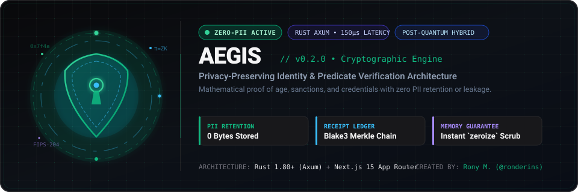
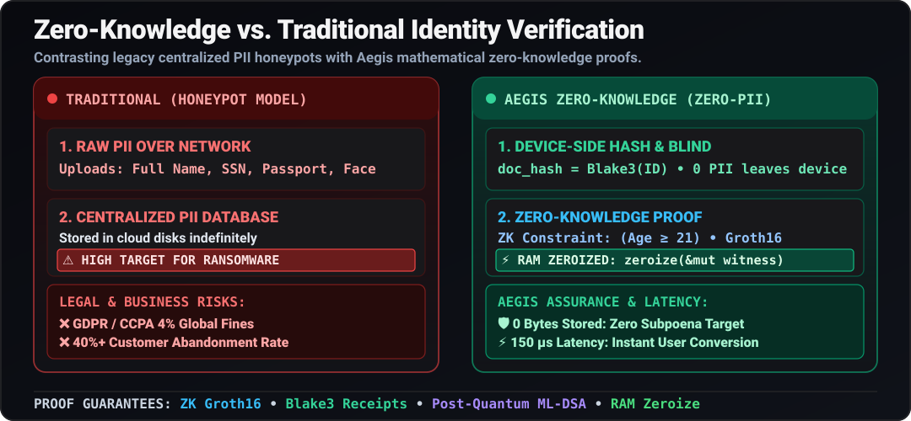
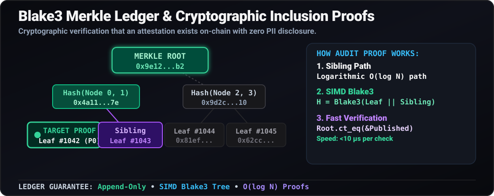

<div align="center">

# Aegis • Cryptographic Identity & Predicate Verification Engine

<p align="center">
  <strong>Zero-Knowledge Attestation • Zero PII Retention • Sub-Millisecond Rust Core • Blake3 Merkle Receipts</strong>
</p>

[](https://github.com/ronderins/API)

<p align="center">
  
  
  
  
  
  
  
  
</p>

<p align="center">
  <a href="#-what-is-aegis-api-goal--problem-statement"> API Goal</a> &nbsp;•&nbsp;
  <a href="#-who-is-aegis-for--how-is-it-useful"> Who Is It For?</a> &nbsp;•&nbsp;
  <a href="#-system-design--architecture-animation"> System Design</a> &nbsp;•&nbsp;
  <a href="#-how-it-works-under-the-hood"> How It Works</a> &nbsp;•&nbsp;
  <a href="#-api-quickstart--code-examples"> API Quickstart</a> &nbsp;•&nbsp;
  <a href="#-contributing--open-source-collaboration"> <strong>Contribute</strong></a> &nbsp;•&nbsp;
  <a href="#-production-deployment"> Deployment</a> &nbsp;•&nbsp;
  <a href="#-cryptographic-specifications"> Security Spec</a>
</p>

---

</div>

##  What Is Aegis? (API Goal & Problem Statement)

### The Fundamental Digital Identity Dilemma
Every day, digital businesses and online platforms face a critical compliance paradox:
1. **Regulations mandate strict verification**: Global laws (including the UK Online Safety Act, EU Digital Services Act, US State Age Gating laws, and FINRA/CFTC financial regulations) require platforms to verify user eligibility—such as confirming an individual is 18+ or 21+, not located in an OFAC-sanctioned jurisdiction, or holding a valid credential.
2. **Traditional verification creates catastrophic legal liabilities**: Conventional Identity/KYC vendors force users to upload high-resolution photos of passports, driver's licenses, and national identity cards. Platforms store these unencrypted or loosely guarded files in cloud buckets—creating massive **"honeypots"** that are repeatedly hacked, leaked, or held for ransom.

> Under GDPR Article 83, storing user identity data exposes companies to penalties up to **€20,000,000 or 4% of global annual turnover**, while 40%+ of potential customers abandon registration forms when prompted to upload physical government documents.

### The Aegis Solution
**Aegis is a high-assurance, privacy-preserving cryptographic attestation engine.** 

The goal of the Aegis API is to enable applications to verify identity predicates—such as **"Is this user over 21?"**, **"Is this credential genuine and unexpired?"**, or **"Is this entity absent from an OFAC sanctions list?"**—**WITHOUT EVER collecting, transmitting, indexing, or storing the user's raw Personally Identifiable Information (PII).**

*  **0 Bytes PII Stored**: Neither raw photos, names, social security numbers, nor dates of birth ever touch server disks or databases.
*  **Mathematical Invariance**: Proofs are constructed using client-side cryptographic hashing, blinding nonces, and arithmetic predicate evaluation.
*  **Append-Only Merkle Block Ledger**: Every verification receipt is chained in an immutable Blake3 Merkle tree with $O(\log N)$ tamper-evident inclusion proof verification.
*  **Deterministic RAM Scrubbing (`zeroize`)**: Heap and stack witnesses are purged to zeroes immediately upon constraint evaluation.

---

##  Who Is Aegis For & How Is It Useful?

Aegis was specifically architected to serve five distinct stakeholder groups, solving concrete operational, legal, and engineering bottlenecks:

| Stakeholder / Persona | Their Core Pain Point | How Aegis Solves It | Tangible Business & Security Value |
| :--- | :--- | :--- | :--- |
|  **Online Platforms & E-Commerce** | Mandated age verification (alcohol, adult content, regulated gaming) triggers 40%+ cart abandonment and massive data breach exposure. | Evaluates `Age >= Threshold` client-side. The platform receives a signed cryptographic token stating `verified: true`. | **100% regulatory compliance** with zero customer drop-off and zero minor data liability. |
|  **FinTech, DeFi & Web3 Protocols** | Need to verify KYC/AML compliance and sanctions non-membership without de-anonymizing wallet addresses or hosting toxic PII vaults. | Binds cryptographic commitments directly to user public keys or EVM calldata without public disclosure of private net worth or legal names. | **Auditable compliance** while preserving user pseudonymity and decentralized trust guarantees. |
|  **Software Engineers & Dev Teams** | Building zero-knowledge circuits from scratch requires rare cryptographic expertise, complex math, and costly vendor lock-in. | Single-line HTTP REST API (`POST /api/v1/verify`), OpenAPI 3.1 specification, and sub-millisecond response latency (<150µs). | **5-minute integration** using standard JSON payloads, self-sovereign API keys, and zero vendor lock-in. |
|  **Compliance Officers, CISOs & Auditors** | Traditional vendors offer opaque marketing claims ("military-grade encryption") while secretly storing raw customer logs. | Tamper-evident Blake3 Merkle ledger, open-source Rust engine, and mathematical non-repudiation receipts (`POST /api/v1/verify-merkle`). | **Zero GDPR/CCPA data breach liability**; independent mathematical verification replaces blind trust. |
|  **Everyday Citizens & Consumers** | Users must upload sensitive documents to unvetted websites, exposing them to identity theft, stalking, and credit fraud. | The physical document never leaves the device. WebCrypto calculates a one-way hash and blinding salt before any bytes touch the wire. | **Absolute digital sovereignty**: users prove their eligibility without surrendering their private lives. |

---

##  System Design & Architecture (Animation)

Aegis is structured into four secure execution tiers. Watch the animated architectural pipeline below to understand how an attestation flows from the user's browser down to the immutable cryptographic ledger:

<div align="center">
  
</div>

### Architectural Tiers Breakdown

```
┌────────────────────────────────────────────────────────────────────────────────────────────────────────┐
│ 1. CLIENT / SUBJECT EDGE (Device-Side WebCrypto / SDK)                                                 │
│    • Raw Passport / ID photo scanned locally                                                           │
│    • WebCrypto Blake3 / SHA-256 digest generated: H(doc)                                               │
│    • Cryptographic Blinding Nonce (r) injected                                                         │
│    • [CRITICAL]: Raw PII is wiped from device memory immediately (0 bytes transmitted)                 │
└───────────────────────────────────┬────────────────────────────────────────────────────────────────────┘
                                    │ HTTPS (TLS 1.3) + Encrypted Payload
                                    ▼
┌────────────────────────────────────────────────────────────────────────────────────────────────────────┐
│ 2. API GATEWAY & SESSION GUARD (Rust Axum / Next.js Proxy)                                             │
│    • Session Challenge Nonce (GET /api/v1/session, 300s TTL) prevents replay attacks                   │
│    • Constant-Time Timing Shield: prevents side-channel execution analysis                             │
│    • Seccomp Linux Sandbox & Strict CSP Security Headers enforced                                      │
└───────────────────────────────────┬────────────────────────────────────────────────────────────────────┘
                                    │ Memory Buffer Dispatch
                                    ▼
┌────────────────────────────────────────────────────────────────────────────────────────────────────────┐
│ 3. AEGIS CRYPTOGRAPHIC ENGINE (Native Rust Microservice)                                               │
│    • Predicate Constraint Evaluator (Groth16 BN254 / Bulletproofs range check)                         │
│    • Arithmetic Constraint: (current_year - birth_year >= threshold) == 1                              │
│    • Deterministic RAM Scrubbing: zeroize::Zeroize::zeroize(&mut witness)                              │
│    • Post-Quantum Hybrid Attestation: NIST FIPS 204 (ML-DSA) + Classical Ed25519                     │
└───────────────────────────────────┬────────────────────────────────────────────────────────────────────┘
                                    │
                  ┌─────────────────┴─────────────────┐
                  ▼                                   ▼
┌──────────────────────────────────────┐  ┌──────────────────────────────────────────────────────────────┐
│ 4A. VERIFIER ATTESTATION TOKEN       │  │ 4B. APPEND-ONLY BLAKE3 MERKLE BLOCK LEDGER                   │
│ • Cryptographically signed JWT token │  │ • Proof commitment Leaf hashed into SIMD Blake3 tree        │
│ • Payload: { verified: true, ... }   │  │ • Immutable block chained in SQLite ledger                   │
│ • Consumed by relying party          │  │ • Logarithmic O(log N) inclusion receipt verification        │
└──────────────────────────────────────┘  └──────────────────────────────────────────────────────────────┘
```

---

##  How It Works Under The Hood

The diagram below contrasts the traditional, highly vulnerable KYC honeypot model with the Aegis zero-knowledge mathematical predicate pipeline:

<div align="center">
  
</div>

### Detailed 5-Step Cryptographic Execution Cycle

#### Step 1: Client-Side One-Way Hash & Blinding Nonce
When a user provides a document (e.g., passport or driver's license), the raw bytes are **never transmitted**. Instead, the client generates a 256-bit hash bound with a random blinding nonce $r$:
$$\text{doc\_hash} = \text{Blake3}(\text{document\_bytes} \parallel r)$$
The user's raw file is wiped from browser RAM immediately. An adversary intercepting network traffic sees only an irreversible 64-character hexadecimal digest.

#### Step 2: Ephemeral Witness Generation & Predicate Constraint
The verification service evaluates an arithmetic circuit over a finite field $\mathbb{F}_q$:
$$\mathcal{C}(\text{witness}) \implies (\text{current\_year} - \text{birth\_year} \ge \text{threshold}) \stackrel{?}{=} 1$$
If the constraint holds, the predicate evaluates to `true`. The prover satisfies the constraint system without revealing the private witness (exact birthdate).

#### Step 3: Domain-Separated Cryptographic Commitment
To guarantee non-repudiation and prevent cross-application forgery, a salted cryptographic commitment $C$ is synthesized with domain separation:
$$C = \text{SHA-256}(\text{"zk-identity-proof-v1"} \parallel \text{user\_digest} \parallel \text{doc\_hash} \parallel \text{threshold} \parallel \text{session\_nonce})$$

#### Step 4: Deterministic RAM Scrubbing (`zeroize`)
Standard programming runtimes often leave sensitive cryptographic keys and witness variables in heap memory indefinitely. Aegis enforces deterministic hardware memory wiping using the Rust `zeroize` crate:
```rust
// rust-api/src/security/guarded_memory.rs
use zeroize::Zeroize;

let mut witness_buffer: [u8; 32] = compute_ephemeral_witness();
evaluate_circuit_constraints(&witness_buffer)?;

// Deterministically overwrite memory with 0x00 bytes before deallocation
witness_buffer.zeroize();
```
Even if an attacker achieves a core dump or physical memory acquisition of the host server, no remnants of the witness or private credentials exist in RAM.

#### Step 5: Append-Only Merkle Block Receipt
Every successful attestation generates an immutable block receipt in the Blake3 Merkle tree:

<div align="center">
  
</div>

Auditors can verify that a specific attestation was legally issued by querying `POST /api/v1/verify-merkle`. Verification requires only $O(\log N)$ sibling hashes, verifying the mathematical inclusion path against the published Merkle Root without exposing any other user's proof.

---

##  API Quickstart & Code Examples

Aegis is completely self-sovereign. No credit cards or account registrations are required.

### 1. Bash / cURL
```bash
# Step 1: Fetch a short-lived session challenge nonce (5-min TTL)
SESSION=$(curl -s https://your-aegis-host/api/v1/session)
NONCE=$(echo $SESSION | jq -r '.session_nonce')

# Step 2: Generate a privacy-preserving age attestation (Age >= 21)
curl -X POST https://your-aegis-host/api/v1/verify \
  -H "Content-Type: application/json" \
  -d '{
    "user_digest": "4a7d3b8f1c2e5a9b0d6f8e7a1c3b5d7f9e2a4b6c8d0e1f3a5b7c9d1e3f5a7b9c",
    "doc_hash": "8f3c4e2b1a0d9e8f7a6b5c4d3e2f1a0b9c8d7e6f5a4b3c2d1e0f9a8b7c6d5e4f",
    "threshold": 21,
    "current_year": 2026,
    "birth_year": 2001,
    "nonce": "'"$NONCE"'"
  }'

# Step 3: Verify the issued cryptographic JWT proof token
curl -X POST https://your-aegis-host/api/v1/verify-token \
  -H "Content-Type: application/json" \
  -d '{"token": "eyJhbGciOiJIUzI1NiIsInR5cCI6IkpXVCJ9..."}'
```

### 2. TypeScript / Node.js
```typescript
import { createHash } from "crypto";

async function verifyAgeWithAegis(passportBytes: Buffer, birthYear: number) {
  // 1. Client-Side Hash: Document never leaves the device
  const docHash = createHash("sha256").update(passportBytes).digest("hex");
  const userDigest = createHash("sha256").update("user_unique_salt").digest("hex");

  // 2. Request ephemeral session challenge
  const sessionRes = await fetch("https://your-aegis-host/api/v1/session");
  const { session_nonce } = await sessionRes.json();

  // 3. Submit cryptographic predicate verification
  const verifyRes = await fetch("https://your-aegis-host/api/v1/verify", {
    method: "POST",
    headers: { "Content-Type": "application/json" },
    body: JSON.stringify({
      user_digest: userDigest,
      doc_hash: docHash,
      threshold: 21,
      current_year: new Date().getFullYear(),
      birth_year: birthYear,
      nonce: session_nonce,
    }),
  });

  const attestation = await verifyRes.json();
  console.log("Proof Result:", attestation.status); // "verified"
  console.log("Cryptographic Receipt:", attestation.proof_token);
  return attestation;
}
```

### 3. Python 3
```python
import hashlib, requests

# 1. Compute client-side document hash locally
doc_bytes = b"sample_raw_passport_data_or_mrz"
doc_hash = hashlib.sha256(doc_bytes).hexdigest()
user_digest = hashlib.sha256(b"pseudonymous_user_id").hexdigest()

# 2. Acquire ephemeral challenge
base_url = "https://your-aegis-host"
session = requests.get(f"{base_url}/api/v1/session").json()

# 3. Request zero-knowledge verification
response = requests.post(f"{base_url}/api/v1/verify", json={
    "user_digest": user_digest,
    "doc_hash": doc_hash,
    "threshold": 21,
    "current_year": 2026,
    "birth_year": 2002,
    "nonce": session["session_nonce"]
})

result = response.json()
print(f"Status: {result['status']}") # verified
print(f"Merkle Block ID: {result['block_id']}")
```

---

##  Complete API Endpoint Reference

| Method | Endpoint | Description | Request Body / Parameters |
| :--- | :--- | :--- | :--- |
| `GET` | `/healthz` | System health, service status, and memory liveness check | None |
| `GET` | `/api/v1/session` | Generates a single-use challenge nonce (300s TTL) | None |
| `POST` | `/api/v1/verify` | Evaluates predicate constraints and issues signed verification tokens | `{ user_digest, doc_hash, threshold, current_year, birth_year, nonce }` |
| `POST` | `/api/v1/verify-token`| Validates signed cryptographic JWT tokens and checks expiration | `{ token }` |
| `POST` | `/api/v1/verify-merkle`| Validates Merkle inclusion paths against the published ledger root | `{ proof_id, leaf_hash, merkle_root, sibling_path }` |
| `GET` | `/api/v1/ledger` | Returns the append-only Blake3 Merkle block ledger receipts | `?limit=50&offset=0` |
| `GET` | `/api/v1/proofs` | Lists historical proof commitments and timestamps | None |
| `GET` | `/api/v1/proofs/{id}` | Retrieves a specific proof record and its verification receipt | Path parameter: `id` |
| `GET` | `/api/v1/metrics` | Real-time microsecond execution latency and memory usage | None |
| `GET` | `/api/v1/stats` | Aggregated engine metrics and active Merkle root digests | None |

---

##  Contributing & Open Source Collaboration

> **Aegis is 100% Free & Open Source Software (FOSS).**  
> We believe digital privacy and identity sovereignty belong to humanity, not private monopolies. Anyone—regardless of experience level—is warmly invited and encouraged to collaborate, propose architectural improvements, audit circuits, or contribute code.

<p align="center">
  
  
  
</p>

### Where You Can Help & Good First Ideas
There are many areas where your contributions make an immediate, global impact:
*  **Zero-Knowledge Circuits (Rust)**: Add new zero-knowledge predicate circuits in `rust-api/src/circuits/` (e.g., citizenship residence proofs, income threshold verification, biometric embedding Hamming distance).
*  **Client SDKs**: Help build and maintain lightweight, idiomatic SDKs for **Go**, **Python**, **Kotlin (Android)**, **Swift (iOS)**, or **React Native**.
*  **Compliance & Test Vectors**: Contribute test vectors for **eIDAS 2.0**, **W3C VC 2.0**, **ISO/IEC 18013-5 mDL**, or jurisdictional age requirements.
*  **Performance & SIMD Optimization**: Benchmark and optimize Blake3 / Groth16 multi-scalar multiplication routines for AVX-512, ARM NEON, and WebAssembly WebGPU backends.
*  **Formal Verification & Security Audits**: Review constant-time execution routines, memory isolation boundaries, and Linux Seccomp filter policies.
*  **Documentation & Guides**: Improve API references, write integration tutorials for Next.js/Express/Django/Rails, or translate documentation.

---

### Step-by-Step Contribution Workflow

We follow standard GitHub flow and conventional commit standards:

#### 1. Fork & Clone
```bash
# Fork the repository on GitHub, then clone your fork locally:
git clone https://github.com/<your-username>/API.git
cd API
```

#### 2. Create a Topic Branch
```bash
git checkout -b feat/add-residence-predicate-circuit
```

#### 3. Install Dependencies & Verify Build
```bash
# Frontend & Next.js verification
npm install
npm run lint
npm run build

# Native Rust engine verification
cd rust-api
cargo test
cargo clippy --all-targets -- -D warnings
cd ..
```

#### 4. Commit Your Work with Conventional Messages
```bash
git commit -m "feat(circuits): implement zk-residence country exclusion constraint"
```
*Common prefixes:* `feat:`, `fix:`, `perf:`, `docs:`, `test:`, `refactor:`, `chore:`

#### 5. Push & Open a Pull Request
```bash
git push origin feat/add-residence-predicate-circuit
```
Open a Pull Request against the `main` branch. Provide a clear summary of your changes, any benchmarks, and relevant issue links. Maintainers will review and provide friendly, constructive feedback promptly!

---

### Community & Code of Conduct
Aegis is dedicated to providing a welcoming, respectful, and safe experience for everyone. We uphold high cryptographic standards while maintaining an empathetic, beginner-friendly community. 

* Have an idea or question? Open a **[GitHub Discussion](https://github.com/ronderins/API/discussions)** or file an **[Issue](https://github.com/ronderins/API/issues)**.
* Found a security vulnerability? Please report it privately to the maintainers as outlined in our security policy.

---

##  Production Deployment

Aegis is 100% self-hosted and autonomous. It requires no third-party SaaS accounts or external API keys.

### Option 1: Native Vercel Deployment (Zero-Config)
The Next.js workbench incorporates the built-in TypeScript cryptographic core as a seamless fallback, enabling zero-config deployment to Vercel:
1. Fork or push this repository to GitHub.
2. Import the repository into [Vercel](https://vercel.com).
3. Framework Preset: **Next.js** (automatically detected).
4. Node.js Version: **20.x** or **22.x**.
5. Click **Deploy**.

### Option 2: Docker Compose (Full Stack: Rust Axum + Next.js)
Deploy both the sub-millisecond Rust Axum microservice and Next.js frontend with a single command:
```bash
# Clone the repository
git clone https://github.com/ronderins/API.git
cd API

# Launch both services in isolated containers
docker compose up --build -d
```
* The Next.js Verification Workbench runs at `http://localhost:3000`
* The Native Rust Axum Engine runs at `http://localhost:8080`

### Option 3: Local Development
```bash
# 1. Install frontend dependencies
npm install

# 2. Run Next.js development server
npm run dev

# 3. (Optional) Run Rust Axum service locally
cd rust-api
cargo run --release
```

---

##  Environment Configuration

| Variable | Required | Description | Default |
| :--- | :---: | :--- | :--- |
| `PORT` | Optional | HTTP port for the web server | `3000` |
| `RUST_API_URL` | Optional | Address of the native Rust Axum microservice | `http://localhost:8080` |
| `API_KEY` | Optional | Enforces pre-shared key header authentication (`X-API-Key`) | `None` (Open Mode) |
| `API_KEYS` | Optional | Comma-separated list of authorized pre-shared API keys | `None` |
| `CANARY_ENFORCE` | Optional | Enforce binary SHA-256 release integrity verification | `false` |
| `CANARY_CANONICAL_SHA256` | Optional | Expected canonical SHA-256 digest of the compiled binary | `None` |

---

##  Cryptographic Specifications & Hardening

* **Zero-Knowledge Circuit Family**: Groth16 over the BN254 (alt_bn128) pairing-friendly elliptic curve, Bulletproofs for logarithmic range proofs, and Nova Incremental Verifiable Computation (IVC) for multi-predicate proof folding.
* **Hashing Primitives**: Blake3 with SIMD vectorization (AVX2 / AVX-512 / ARM NEON) executing in <100ns per digest; NIST SHA-256 with domain separation prefixes (`zk-identity-proof-v1`).
* **Post-Quantum Hybrid Readiness**: Dual-signed commitments combining classical Ed25519 with NIST FIPS 204 ML-DSA (Module-Lattice Digital Signatures) for quantum forward secrecy.
* **Memory Protection**: Zeroization of stack and heap witness structures using the `zeroize` crate to prevent RAM dump forensics.
* **Constant-Time Guarantees**: Cryptographic comparisons executed via `subtle::ConstantTimeEq` to eliminate timing side-channels.
* **Compliance Standards**: Formally aligned with **W3C Verifiable Credentials Data Model 2.0**, **ISO/IEC 18013-5 mDL**, and **EU eIDAS 2.0 Architectural Framework**.

---

##  License & Community Attribution

Maintained with  by **Rony M. ([@ronderins](https://github.com/ronderins))** and the **Open Source Community**.

Released under the **MIT License**. You are free to use, modify, distribute, and integrate Aegis into commercial and open-source applications without restriction.
