# Aegis

Privacy-preserving identity and predicate verification engine. Verify age and credential eligibility over HTTP without receiving, processing, or storing personal identifiable information (PII).

<p align="center">
  
</p>

<p align="center">
  <a href="LICENSE"></a>
  <a href="https://nextjs.org/"></a>
  <a href="https://www.rust-lang.org/"></a>
  <a href="https://github.com/ronderins"></a>
</p>

---

## Overview

Traditional identity verification architectures force users to upload clear, unredacted scans of passports, driver's licenses, or national ID cards to central cloud servers. This paradigm creates centralized honeypots of high-value user data, exposes businesses to severe breach liabilities under regulations like GDPR (up to €20M or 4% of global turnover) and CCPA, and causes high customer abandonment rates.

Aegis decouples **eligibility verification** from **data retention**:

1. **Client-Side Hashing**: The user's device calculates a cryptographic digest of identity attributes locally via WebCrypto. Raw documents never touch the wire.
2. **Predicate Verification**: The backend verifies arithmetic constraints (e.g., `CurrentYear - BirthYear >= 21`) against the document commitment without learning birthdates or identity values.
3. **Signed Proof Tokens & Receipts**: Aegis issues a tamper-evident, signed JWT proof token and records an immutable leaf in an append-only Blake3 Merkle tree.
4. **Hardware Memory Zeroization**: Stack and heap buffers containing witness values implement `ZeroizeOnDrop` to prevent forensic memory scraping.

<p align="center">
  
</p>

---

## End-to-End System Architecture

The Aegis verification pipeline is organized into four decoupled operational layers designed for sub-millisecond execution and strict data isolation:

<p align="center">
  
</p>

### 1. Client Edge
Document hashing occurs exclusively within user hardware using WebCrypto or native platform crypto libraries. Raw biometric scans, photos, and passport numbers never leave the user's device.

### 2. Transport Shield & API Gateway
- **Anti-Replay Protection**: Single-use cryptographic challenge nonces with 300-second TTL prevent replay attacks.
- **Sliding-Window Rate Limiting**: An in-memory token bucket keyed on hashed client IP protects against denial-of-service and credential stuffing.
- **Constant-Time Evaluation**: All signature and token validation operations execute with branchless, constant-time byte comparisons to thwart timing side channels.

### 3. Verification Core
- **Arithmetic Predicate Check**: Evaluates whether the prover satisfies the condition (e.g., $Age \ge Threshold$) using 7-bit decomposition to prevent arithmetic underflow.
- **Domain-Separated Commitments**: Hashed commitments use the `zk-identity-proof-v1` domain separator to prevent cross-protocol collision attacks.
- **Instant Memory Zeroization**: Heap buffers and intermediate witness representations implement `ZeroizeOnDrop`, immediately overwriting RAM with zeroes after proof evaluation.

### 4. Append-Only Merkle Ledger
- **Parallel Blake3 Tree**: Leaf commitments are appended to an immutable Merkle tree.
- **Logarithmic Receipts**: External auditors can mathematically verify proof inclusion in $O(\log N)$ operations without decrypting or accessing private user credentials.

---

## Quickstart & Developer Workflow

Integrating Aegis into any application requires three simple HTTP steps:

<p align="center">
  
</p>

### Step 1: Request Ephemeral Session Nonce
Acquire a single-use challenge nonce to bind the upcoming verification to an unreplayable 300-second window:

```bash
curl -s http://localhost:3000/api/v1/session
```

Response:
```json
{
  "session_nonce": "9e12bf4a-7c3d-4e8f-9a1b-0d2e3f4a5b6c",
  "expires_in": 300
}
```

### Step 2: Submit Verification Request
Send the client-side document digest, pseudonymized user reference, and required threshold:

```bash
curl -X POST http://localhost:3000/api/v1/verify \
  -H "Content-Type: application/json" \
  -d '{
    "user_id": "customer-alice-492",
    "doc_hash": "e3b0c44298fc1c149afbf4c8996fb92427ae41e4649b934ca495991b7852b855",
    "age_threshold": 21
  }'
```

Response:
```json
{
  "proof_id": "prf_8f3c4e2b1a0d9e8f",
  "criteria_met": "age_over_21",
  "commitment": "b2f6d7e9a1b8c3d4dc0af8e9f0b1c2d3a4b5c6d7e8f90a1b2c3d4e5f60718293",
  "proof_signature": "eyJhbGciOiJIUzI1NiIsInR5cCI6IkpXVCJ9...",
  "merkle_root": "0x4a7d3b8f1c2e5a9b0d6f8e7a1c3b5d7f9e2a4b6c8d0e1f3a5b7c9d1e3f5a7b9c",
  "timestamp": 1774313545
}
```

### Step 3: Verify Existing Proof Token
Validate a signed proof token on any downstream microservice without database access:

```bash
curl -X POST http://localhost:3000/api/v1/verify-token \
  -H "Content-Type: application/json" \
  -d '{
    "token": "eyJhbGciOiJIUzI1NiIsInR5cCI6IkpXVCJ9..."
  }'
```

---

## Zero-Knowledge Circuit & Constraint System

<p align="center">
  
</p>

The core circuit translates high-level identity predicates into rank-1 constraint systems (R1CS) and range checks:
- **Private Witness ($w_0$)**: Secret document hash and birth year known only to the user.
- **Public Inputs ($c_0$)**: Evaluation year ($2026$) and required threshold ($18$, $21$, etc.).
- **Range Comparator**: Enforces that the calculated delta falls within valid physical ranges $[0, 150]$ using bit decomposition gates, preventing integer wraparound attacks.
- **Commitment Collector**: Emits a deterministic domain-separated hash commitment without leaking the private inputs.

---

## Merkle Ledger & Cryptographic Receipts

<p align="center">
  
</p>

Every minted proof produces a leaf in the append-only Blake3 Merkle tree:
- **Tamper-Evident Chaining**: Each block receipt is cryptographically bound to the root of previous states.
- **Logarithmic Inclusion Audits**: Any compliance officer or third-party auditor can verify a proof's existence and validity in $O(\log_2 N)$ steps by calling `POST /api/v1/verify-merkle`.
- **Zero Data Exposure**: Merkle leaves contain only SHA-256 commitments and block hashes—no names, emails, or biometric vectors.

---

## Code Examples

### TypeScript / Node.js
```typescript
import { createHash } from "crypto";

interface VerifyResponse {
  proof_id: string;
  criteria_met: string;
  commitment: string;
  proof_signature: string;
  merkle_root?: string;
}

export async function verifyAgeEligibility(
  documentBuffer: Buffer,
  pseudonymousUserId: string,
  requiredAge = 21
): Promise<VerifyResponse> {
  const AEGIS_URL = process.env.AEGIS_URL || "http://localhost:3000";

  // 1. Hash document locally on device (raw bytes never transmitted)
  const docHash = createHash("sha256").update(documentBuffer).digest("hex");

  // 2. Dispatch verification request
  const response = await fetch(`${AEGIS_URL}/api/v1/verify`, {
    method: "POST",
    headers: { "Content-Type": "application/json" },
    body: JSON.stringify({
      user_id: pseudonymousUserId,
      doc_hash: docHash,
      age_threshold: requiredAge,
    }),
  });

  if (!response.ok) {
    throw new Error(`Verification failed with status ${response.status}`);
  }

  return (await response.json()) as VerifyResponse;
}
```

### Python 3
```python
import hashlib
import requests

AEGIS_URL = "http://localhost:3000"

# 1. Compute document digest locally
raw_doc_bytes = b"passport_scan_data"
doc_hash = hashlib.sha256(raw_doc_bytes).hexdigest()

# 2. Submit verification request
res = requests.post(f"{AEGIS_URL}/api/v1/verify", json={
    "user_id": "customer-bob-883",
    "doc_hash": doc_hash,
    "age_threshold": 21
})

data = res.json()
print("Criteria met:", data.get("criteria_met"))
print("Proof commitment:", data.get("commitment"))
```

### Rust
```rust
use reqwest::Client;
use serde_json::json;

#[tokio::main]
async fn main() -> Result<(), Box<dyn std::error::Error>> {
    let client = Client::new();
    let res = client
        .post("http://localhost:3000/api/v1/verify")
        .header("Content-Type", "application/json")
        .json(&json!({
            "user_id": "customer-clara-210",
            "doc_hash": "8f434346648f6b96df89dda901c5176b10a6d83961dd3c1ac88b59b2dc327aa4",
            "age_threshold": 21
        }))
        .send()
        .await?;

    println!("Status: {}", res.status());
    println!("Response: {}", res.text().await?);
    Ok(())
}
```

---

## API Reference

All endpoints return JSON and use standard HTTP status codes.

| Method | Endpoint | Description |
| :--- | :--- | :--- |
| `GET` | `/healthz` | System health check and engine liveness status |
| `GET` | `/api/v1/session` | Generates a single-use replay challenge nonce (300s TTL) |
| `POST` | `/api/v1/verify` | Evaluates predicate constraints and issues signed verification tokens |
| `POST` | `/api/v1/verify-token` | Validates signed cryptographic JWT tokens and checks expiration |
| `POST` | `/api/v1/verify-merkle` | Validates Merkle inclusion paths against the published ledger root |
| `GET` | `/api/v1/ledger` | Returns append-only Merkle block ledger receipts |
| `GET` | `/api/v1/proofs` | Lists historical proof commitments and timestamps (Zero PII) |
| `GET` | `/api/v1/proofs/{id}` | Retrieves a specific proof record and its verification receipt |
| `GET` | `/api/v1/metrics` | Microsecond execution latency and memory usage |
| `GET` | `/api/v1/stats` | Real-time counts of proofs minted and audit log entries |

---

## Security Invariants

* **Zero PII Footprint**: Neither document photos, names, nor dates of birth are ever written to disk or logged.
* **Memory Zeroization**: Stack and heap buffers containing intermediate witness variables implement `ZeroizeOnDrop` to prevent forensic memory dumps.
* **Anti-Replay Mechanism**: Nonces are tied to single verification requests and expire after 300 seconds.
* **Constant-Time Comparison**: Cryptographic tokens and hashes are validated using constant-time byte comparisons to protect against timing side-channel attacks.
* **Merkle Receipts**: Attestations can be audited against the append-only Merkle tree root without disclosing any personal data.

---

## Local Setup

### Option 1: Next.js Full Stack (Default)
Runs Next.js App Router with the built-in cryptographic engine on port 3000:

```bash
npm install
npm run dev
```

Visit [http://localhost:3000](http://localhost:3000).

### Option 2: Docker Compose (Next.js + Rust Axum Engine)
Runs the native Rust engine on port 8080 with Next.js running on port 3000:

```bash
docker compose up --build
```

---

## License

This project is licensed under the MIT License. See [LICENSE](LICENSE) for details.
